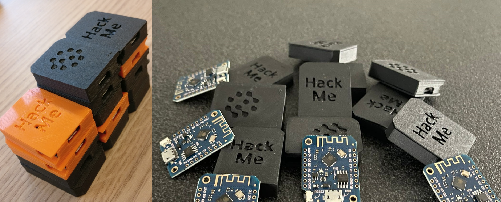

# RootNode, an ESP8266 based hackable IoT device

RootNode is an ESP8266 based IoT device containing intentionally designed vulnerabilities for practising ethical hacking in a controlled environment. The project is inspired by the OWASP IoT Top 10 (2018) and demonstrates vulnerabilities such as weak or hardcoded passwords, insecure network services, insufficient access control, insecure data storage, buffer overflows and a lack of physical hardening.

The practical objectives and supporting hints are available in [`Goals.pdf`](documentation/Goals.pdf). Detailed explanations of the vulnerabilities and their solutions can be found in [`Exploitable_vulnerabilities_and_answers.pdf`](documentation/Exploitable_vulnerabilities_and_answers.pdf).

This README provides the technical information required to set up the project. It describes the required hardware and software, explains how to install and upload the firmware and filesystem, and covers the initial Wi-Fi configuration and basic device usage.

> RootNode builds on ideas developed during an earlier university of applied sciences group project. I would like to acknowledge and thank the three other team members who contributed to that original project. Their names are not listed here until I have received their permission to publish them.

> RootNode is intended exclusively for education and authorized security testing. Do not use the techniques demonstrated by this project against devices or networks without explicit permission.

## Getting Started

These instructions will help you set up and run the project on a D1 Mini or another ESP8266-based development board for development and ethical hacking exercises.

The project has been tested on the boards listed below. Other ESP8266-based boards may also work but have not been officially verified.
* [D1 Mini ESP8266](https://www.az-delivery.de/nl/collections/d1-mini)

### Hardware

The following hardware is required:
* 1x [D1 Mini ESP8266](https://www.az-delivery.de/nl/collections/d1-mini)
* 1x USB-A to MicroUSB cable
* (optional) 1x RootNode casing

### Dependencies

The following software is required:
* [Arduino IDE](https://www.arduino.cc/en/software/) (Tested with v1.8.19)
* [ESP8266 toolchain for Arduino IDE](https://randomnerdtutorials.com/how-to-install-esp8266-board-arduino-ide/)
* [ESP8266 filesystem uploader Arduino IDE](https://randomnerdtutorials.com/install-esp8266-filesystem-uploader-arduino-ide/)

### External libaries

* [ESP8266 Web Server](https://github.com/esp8266/Arduino/tree/master/libraries/ESP8266WebServer)

## Installing

1. Navigate to the `RootNode` folder.
2. Open `software/RootNode.ino`.
3. Select the `LOLIN(WeMos) D1 R1` (or `WeMos D1 R1`) board.
4. Upload the files in the `data` folder with `Tools -> ESP8266 Sketch Data Upload`.
5. Upload the firmware to the device.

### Running

1. Boot the device.
2. Connect to the `Config RootNode WiFi XXXXXX` AP to configure the WiFi network.
3. Go to the IP address listed in the serial monitor. Most of the time this is [http://192.168.4.1](http://192.168.4.1).
4. Follow the steps on the website to configure a WiFi connection.
5. The device should restart, connect to the selected WiFi network and be ready for use.

## Contributing

When contributing to this repository, please read [CONTRIBUTING.md](CONTRIBUTING.md), [HTML/CSS/JavaScript conventions](documentation/software/HTML_CSS_JAVASCRIPT_CONVENTIONS.md) and [C/C++ conventions](documentation/software/CPP_CONVENTIONS.md).

## Authors

* **Luke de Munk** - *Head author* - [LinkedIn](https://www.linkedin.com/in/luke-de-munk/)